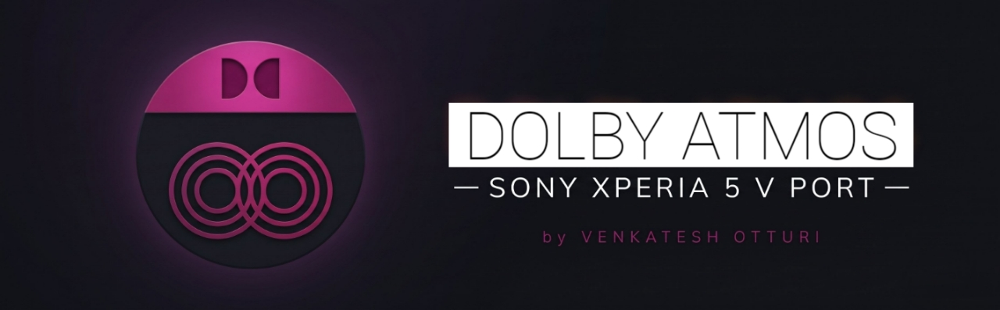
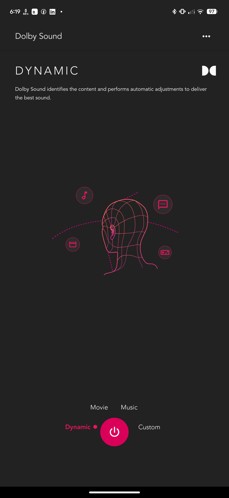
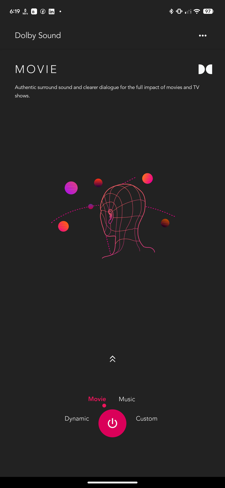
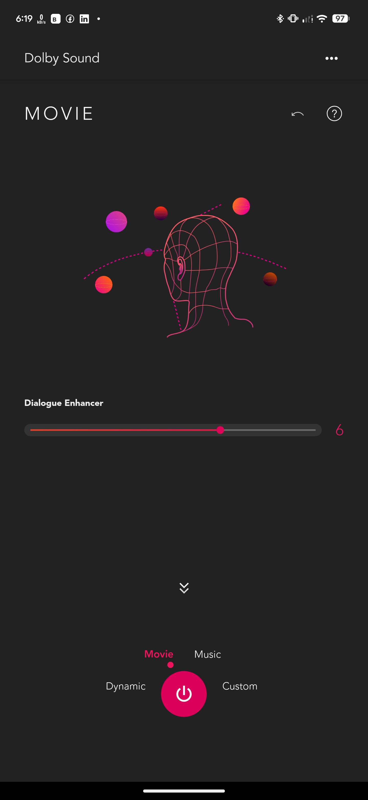
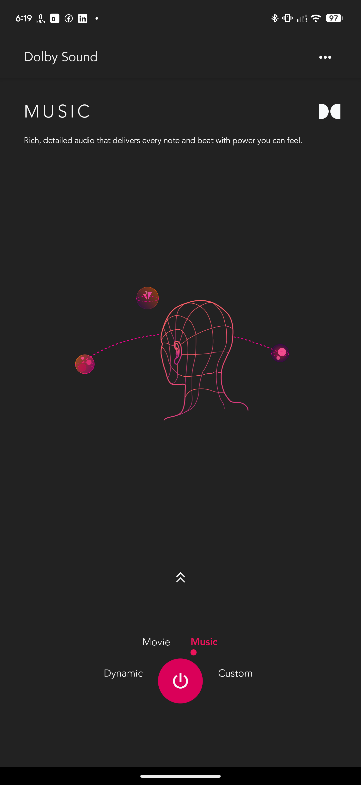
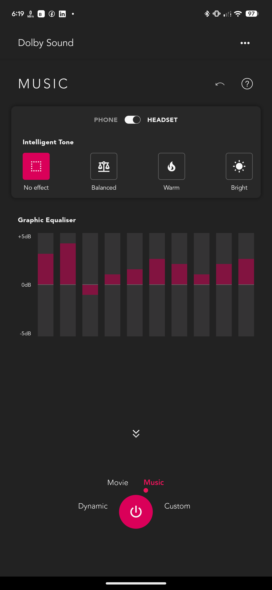
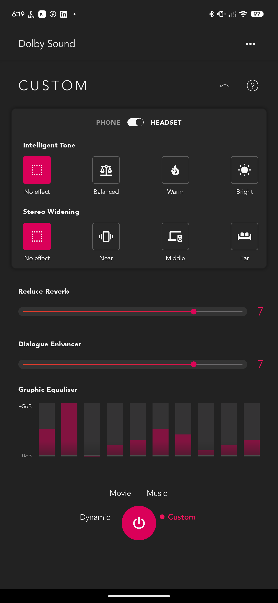
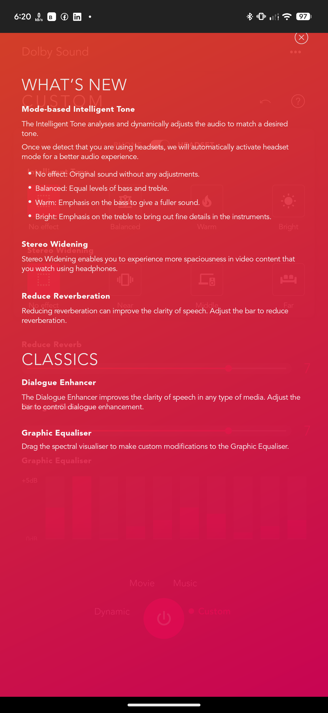

  

  <h1>Dolby Atmos — Sony Xperia 5 V Port</h1>
  
<b>System-Wide Spatial Audio & Graphic Equalizer for Modern Android (Official Magisk & Read-Only ROMs)</b>

  

    
    
    
    
  

  

    
    
    
  

---

### ✨ Overview

A modernized, split-architecture port of the **Sony Xperia 5 V (`pdx237`) Dolby Atmos** sound engine, engineered to run smoothly on **Official Magisk**, **KernelSU**, and **APatch**—including strict **Read-Only (`EROFS` / `EXT4`)** stock and custom ROMs without bootloops.

This release requires **two components** working together:
1. **Sony Dolby Atmos Magisk Module (Drivers & Services)** — Installs the systemless audio libraries, `daxService`, and native DMS hardware daemon.
2. **Sony Dolby Atmos Standalone APK (UI App)** — Provides the Sony Xperia equalizer and spatial audio control interface.

---

### 📱 Screenshots

  
  
  
    
  
  
  
    
  

---

### 🚀 Key Improvements & Fixes

- **Persistent System-Wide Processing (Session 0):** Keeps `com.dolby.daxservice` active in the background and exempt from Doze/AppOps throttling so Dolby effects stay active across Spotify, YouTube, Poweramp, and games—not just inside the Dolby UI.
- **Real-Time UI State Synchronization:** Fixed the `MusicSubFragment` `NullPointerException` crash-relaunch loop (`mMusicOffHeadImage`) so preset toggles, EQ bands, and virtualizer buttons update instantaneously on tap.
- **Modern SDK & Hidden API Compatibility:** Automatically applies hidden API policy exemptions so the standalone user-space APK links cleanly to Android's `AudioEffect` framework on Android 14–17+.
- **Read-Only ROM & Official Magisk Safe:** Cleanly initializes `vendor.dolby.hardware.dms@2.0-service` and merges audio configs without requiring Magisk Delta/Kitsune early-init workarounds.
- **Multi-Mod Friendly:** Compatible alongside other audio mods when paired with **Audio Modification Library (AML)**.

---

### 📥 How to Install

> [!IMPORTANT]
> **Both files are required.** You must flash the **Sony Dolby Atmos Magisk Module** and reboot **before** installing the **Sony Dolby Atmos Standalone APK**.

1. **Download Both Files** from [**Releases**](https://github.com/venky6158/DolbyAtmos-SonyXperia5V-Releases/releases/latest):
   - `DolbyAtmos-SonyXperia5V-Driver-Only.zip` *(Magisk Driver Module)*
   - `DolbyAtmos-SonyXperia5V-Standalone.apk` *(Sony Dolby Atmos UI App)*
2. **Flash the Magisk Module:**
   - Open **Official Magisk** (or KernelSU / APatch) → **Modules** → **Install from storage**.
   - Select `DolbyAtmos-SonyXperia5V-Driver-Only.zip` and wait for installation to complete.
3. **Reboot Your Device:**
   - Restart your phone so the native `dms@2.0-service` daemon and `daxService` initialize properly.
4. **Install the Standalone APK:**
   - After rebooting, install `DolbyAtmos-SonyXperia5V-Standalone.apk` like a normal Android app and launch it.
5. *(Optional)* If you use additional audio mods simultaneously, flash [**Audio Modification Library (AML)**](https://github.com/Magisk-Modules-Repo/aml) so all effects chain cleanly on Session 0.

> [!NOTE]
> - **Custom EQ Sliders:** Switch from **Dynamic** to **Custom** profile inside the app to unlock the 10-band Graphic Equalizer, Surround Virtualizer, and Dialogue Enhancer.
> - **Independent Device Profiles:** Dolby maintains separate sound profiles for **Phone Speaker**, **Wired Headphones**, and **Bluetooth** devices.

---

### 🙏 Credits & Developer

- **Dolby Laboratories & Sony Mobile** — Original Xperia 5 V (`pdx237`) audio binaries and DSP tuning.
- **[Rei Ryuki](https://github.com/reiryuki)** — Foundational [Dolby Atmos Sony Xperia 5 V Magisk Module](https://github.com/reiryuki/Dolby-Atmos-Sony-Xperia-5-V-Magisk-Module) and reverse-engineering research.
- **Venkatesh Otturi** — Modern Android / Official Magisk & Read-Only ROM port, background persistence fixes, and standalone APK patches.
  - **GitHub:** [@venky6158](https://github.com/venky6158)
  - **Telegram:** [@venky6158](https://t.me/venky6158)
  - **Instagram:** [@venky6158](https://instagram.com/venky6158)
  - **LinkedIn:** [linkedin.com/in/venkateshotturi](https://www.linkedin.com/in/venkateshotturi/)
